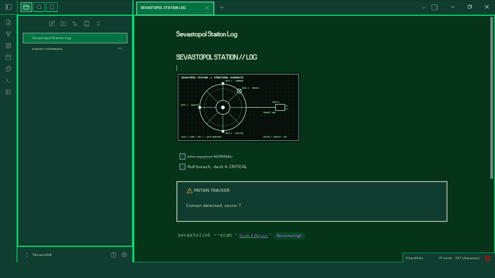

# Sevastolink

A lo-fi sci-fi theme for [Obsidian](https://obsidian.md) inspired by the Sevastolink computers from *Alien: Isolation*. Monochromatic green-on-black, CRT aesthetics, grid layouts and utilitarian design.

## Install

**Manual:** download `theme.css` and `manifest.json` from the latest release into `<your vault>/.obsidian/themes/Sevastolink/`, then pick **Sevastolink** under *Settings → Appearance → Themes*.

## Font

The theme's CSS asks for the `Glass TTY VT220` font and falls back to your system default if it isn't installed. For a closer match, install a VT220-style terminal font such as [Glass TTY VT220](https://sensi.org/~svo/glasstty/).

For an *Alien: Isolation* interface look, [Sevastopol Interface](http://fontstruct.com/fontstructions/show/1132894) by RNRCFan is also worth a try. It's released under the FontStruct Non-Commercial License, so it isn't bundled here.

## Credits

*Alien: Isolation* is the property of its respective owners. This is an unofficial fan project and is not affiliated with or endorsed by them.

## License

[MIT](LICENSE)
